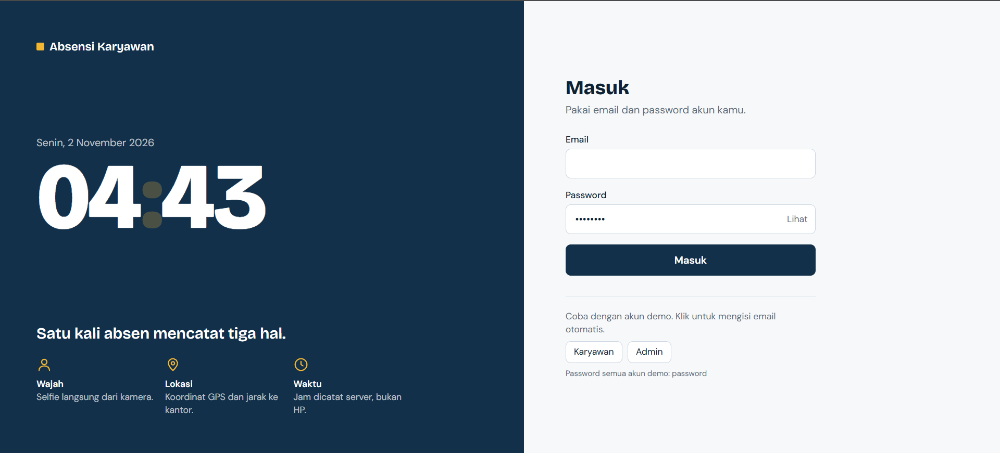
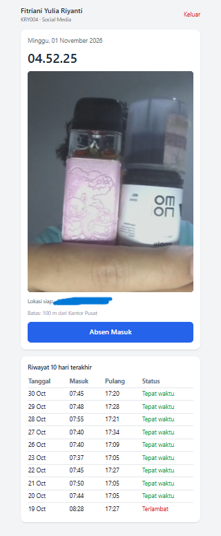
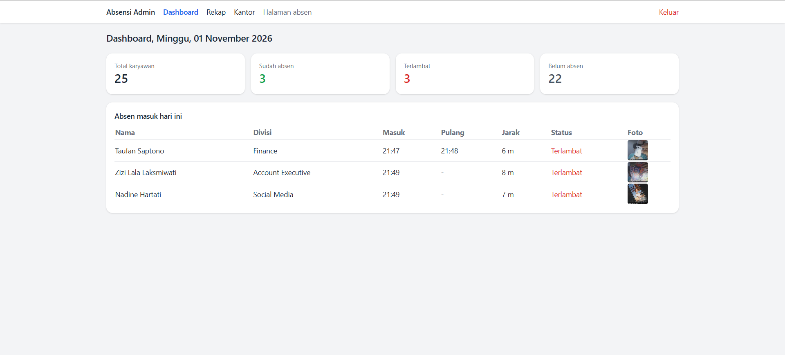
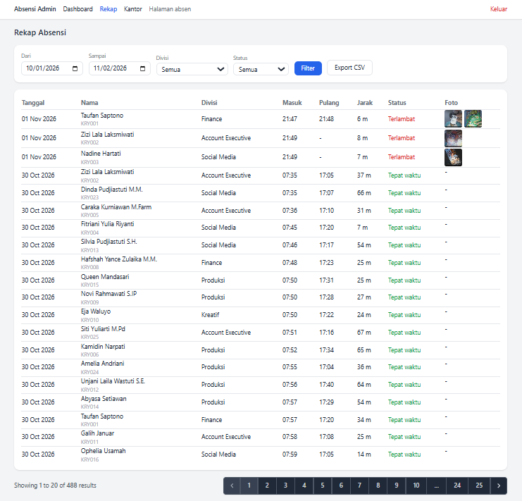
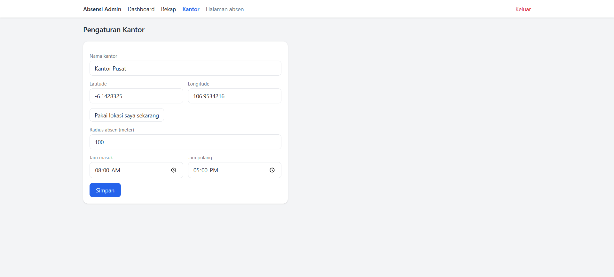
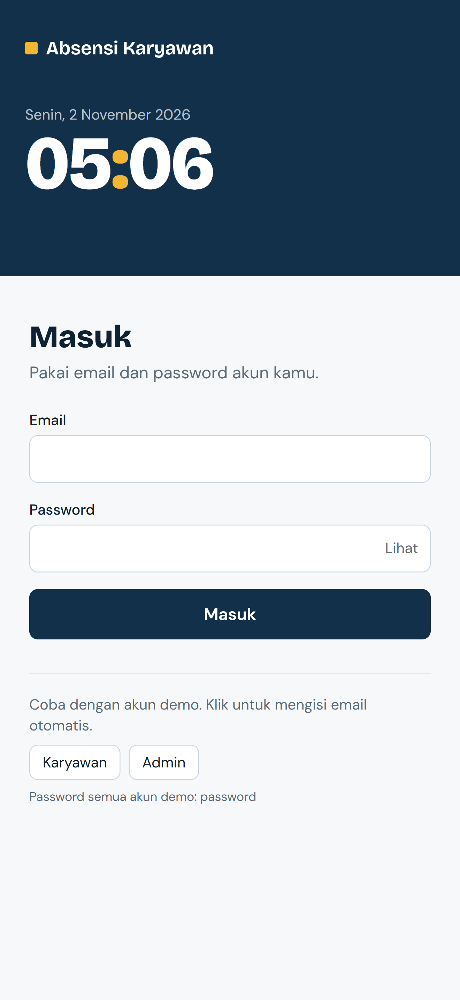

# Absensi Karyawan

Aplikasi absensi berbasis web dengan verifikasi **selfie**, **lokasi GPS**, dan **timestamp dari server**. Project demo yang gua buat buat nunjukin alur absensi karyawan dari sisi karyawan sampai sisi admin.

## Fitur

**Karyawan**
- Login, lalu absen masuk dan pulang lewat kamera browser (selfie).
- Koordinat GPS diambil otomatis, jaraknya ke kantor dihitung (rumus haversine). Di luar radius, absen ditolak.
- Waktu absen dicatat dari server, bukan dari jam HP, jadi gak bisa diakalin dengan ganti jam.
- Status tepat waktu atau terlambat ditentukan otomatis dari jam masuk kantor.
- Riwayat absen 10 hari terakhir.

**Admin**
- Dashboard harian: total karyawan, yang sudah absen, terlambat, dan belum absen.
- Rekap absensi dengan filter tanggal, divisi, dan status, plus export CSV.
- Foto bukti absen masuk dan pulang bisa dilihat langsung di tabel.
- Pengaturan kantor: lokasi, radius, dan jam masuk/pulang.

## Tech Stack

- Laravel (PHP, MVC)
- MySQL
- Tailwind CSS (via CDN)
- JavaScript (Camera API dan Geolocation API bawaan browser)

## Cara Menjalankan

Butuh PHP, Composer, dan MySQL (misal lewat Laragon).

```bash
git clone https://github.com/Ell-LaLaLostyou/absensi-karyawan.git
cd absensi-karyawan
composer install
cp .env.example .env
php artisan key:generate
```

Buat database kosong bernama `absensi_demo`, lalu atur bagian database di `.env`:
DB_CONNECTION=mysql
DB_HOST=127.0.0.1
DB_PORT=3306
DB_DATABASE=absensi_demo
DB_USERNAME=root
DB_PASSWORD=
APP_TIMEZONE=Asia/Jakarta
Lanjut:

```bash
php artisan migrate --seed
php artisan storage:link
php artisan serve
```

Buka `http://127.0.0.1:8000`.

> Kamera dan GPS di browser cuma jalan di `localhost`/`127.0.0.1` atau situs HTTPS. Jangan buka lewat alamat `.test` atau IP biasa, izin kameranya bakal diblok browser.

## Data dan Akun Demo

Seeder bikin 1 admin, 25 karyawan, dan riwayat absen 30 hari terakhir (data hari ini sengaja dikosongin buat dicoba langsung).

| Role | Email | Password |
|------|-------|----------|
| Admin | admin@demo.test | password |
| Karyawan | karyawan1@demo.test sampai karyawan25@demo.test | password |

Lokasi kantor bawaan seeder cuma titik contoh. Buat nyoba absen, login sebagai admin, buka menu **Kantor**, lalu klik "Pakai lokasi saya sekarang" dan simpan.

## Struktur Database

- `users`: akun, NIP, role (admin/karyawan), jabatan, divisi
- `offices`: lokasi kantor, radius, jam masuk dan pulang
- `attendances`: absen per karyawan per hari (waktu, koordinat, jarak, path foto, status masuk dan pulang)

## Screenshot

| Login | Absen |
|---|---|
|  |  |

| Dashboard Admin | Rekap |
|---|---|
|  |  |



## Catatan

- Tailwind dipasang lewat CDN, jadi butuh koneksi internet buat tampilan.
- Selfie disimpan sebagai bukti, belum ada pengenalan wajah.
- Lokasi GPS dari browser masih bisa dipalsukan dengan tools tertentu. Buat pemakaian sungguhan perlu lapisan tambahan (misal aplikasi mobile dengan deteksi mock location).
- Ide pengembangan: pengajuan izin/cuti, notifikasi, banyak lokasi kantor, shift per karyawan.

